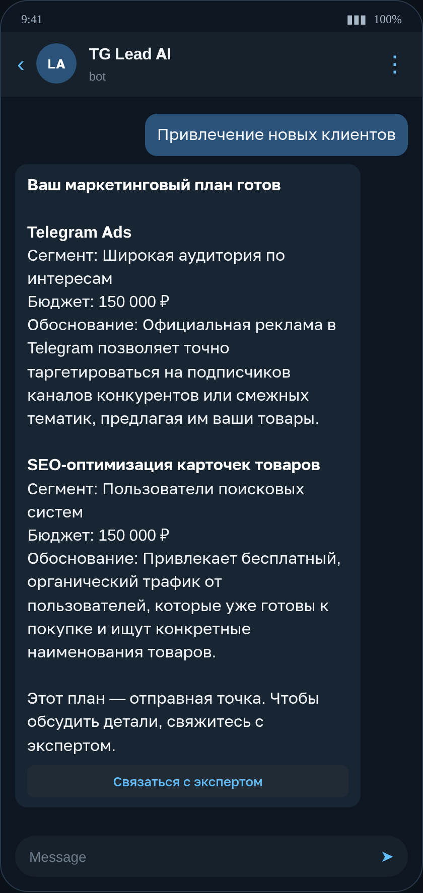

# TG Lead AI

**AI-Strategist: квалификация лидов и маркетинговый план в Telegram.**

[](#запуск)
[](#как-устроено)
[](#тесты)
[](#как-устроено)
[](LICENSE)

**[Открыть case study →](https://jefo.github.io/tg-lead-ai/)**



---

## Что это

Бот задаёт три вопроса — отрасль, бюджет, цель — и собирает маркетинговый план из готовых гипотез. В конце предлагает связаться с экспертом и отправляет квалифицированный лид владельцу.

«AI» здесь означает не LLM, а **детерминированную экспертную систему**: правила и гипотезы лежат в JSON, состояние диалога ведёт конечный автомат. Это сделано намеренно: план воспроизводим, его можно проверить и объяснить.

---

## Что умеет

- Диалог из трёх шагов: отрасль → бюджет → цель.
- 4 отрасли и 6 готовых гипотез в `business-logic.json`.
- Декларативный граф диалога в `dialog-flow.config.ts`.
- Генерация плана: гипотезы, сегмент, потребность, бюджет, обоснование.
- Распределение бюджета между гипотезами.
- CTA «Связаться с экспертом».
- Квалификация лида и уведомление владельца.
- 10 тестов, включая полный сценарий от `/start` до `LEAD_QUALIFIED`.

---

## Сценарий

```mermaid
flowchart TD
    A[/start] --> B[Отрасль]
    B --> C[Бюджет]
    C --> D[Цель]
    D --> E[Генерация плана]
    E --> F[План]
    F -->|Связаться с экспертом| G[Лид квалифицирован]
    G --> H[Уведомление владельцу]
```

---

## Запуск

Нужен [Bun](https://bun.com) и токен от [@BotFather](https://t.me/BotFather).

```bash
bun install
cp .env.example .env
```

В `.env`:

```env
BOT_TOKEN=123456:AA...
```

```bash
bun run start
```

Проверки:

```bash
bun test
bunx tsc --noEmit
```

---

## Структура

```text
src/
├── domain/
│   ├── dialog-flow.config.ts
│   ├── state-machine.service.ts
│   ├── hypothesis-generator.service.ts
│   └── ports/
├── use-cases/
│   ├── handle-user-interaction.use-case.ts
│   ├── get-marketing-plan.use-case.ts
│   ├── qualify-lead.use-case.ts
│   └── actions.ts
└── infrastructure/
    ├── telegram/telegram.gateway.ts
    ├── persistence/
    └── notifications/
```

---

## Как устроено

- **Домен** содержит чистый переход состояний и генерацию гипотез. Без Telegram и без БД.
- **Use cases** оркестрируют диалог, генерацию плана и квалификацию лида.
- **Инфраструктура** подставляет Telegraf, in-memory состояние, JSON-репозиторий и консольные уведомления.
- **`business-logic.json`** можно менять без правки кода: добавить отрасль или гипотезу.
- **`docs/ux-flow.md`** — исходное описание сценария.
- **`docs/system-model.md`** — системная модель: стейкхолдеры, требования, архитектура, V&V.

Поток:

```text
handleInteraction()
  → runTransition()
  → actions (saveIndustry / saveBudget / saveGoal / triggerPlanGeneration)
  → getMarketingPlan()
  → PLAN_DELIVERED
  → qualifyLead()
  → LEAD_QUALIFIED
```

---

## Тесты

```text
10 pass
0 fail
22 expect() calls
```

Покрыто:

- генерация гипотез и распределение бюджета;
- чтение правил из JSON;
- переходы конечного автомата;
- ошибка при отсутствующем action;
- полный сценарий до квалифицированного лида.

---

## Ограничения

- **Нет LLM.** «AI» — это правила в JSON, не модель.
- **Состояние in-memory.** При перезапуске диалоги сбрасываются.
- **Нет базы и CRM.** Лид уходит в консольный адаптер.
- **Нет реальной отправки владельцу.** Нужно подключить Telegram-чат или вебхук.
- **План шаблонный.** Гипотезы и метрики — заготовки, а не прогноз.
- **Нет A/B-тестов и аналитики.**
- **Нет авторизации.** Любой пользователь проходит сценарий.

---

## Что дальше

- Подключить уведомление владельцу в Telegram.
- Перенести состояние в Redis/Postgres.
- Добавить отраслей и гипотез.
- Сделать генерацию плана на LLM с проверкой фактов.
- Добавить CRM-интеграцию и статусы лидов.
- Собирать воронку: старт → план → CTA.

---

## Лицензия

MIT.
